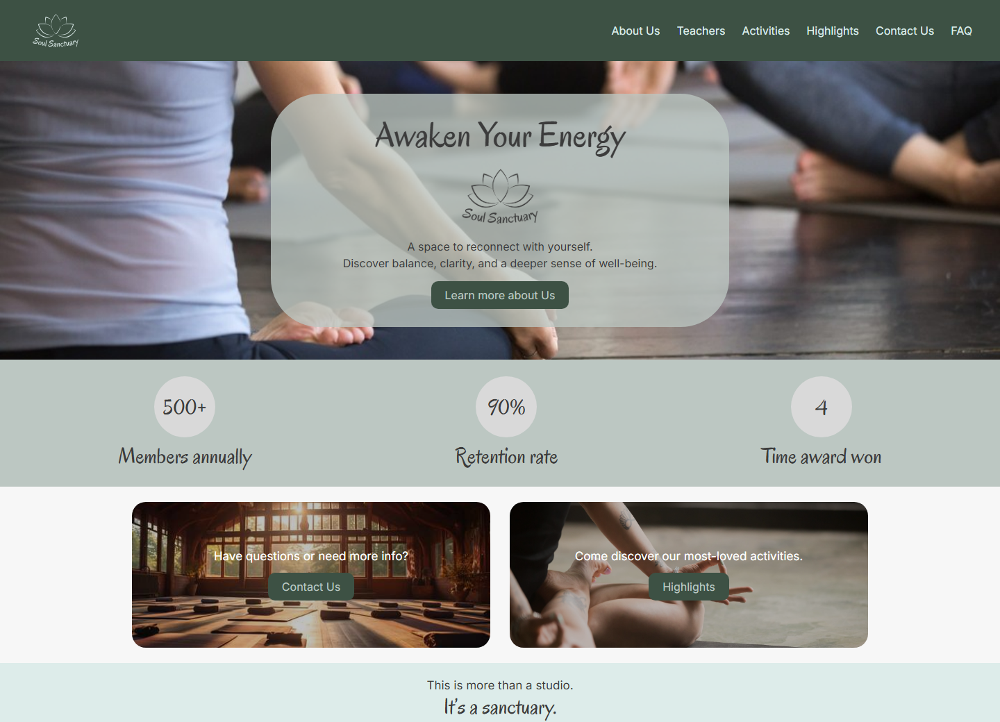
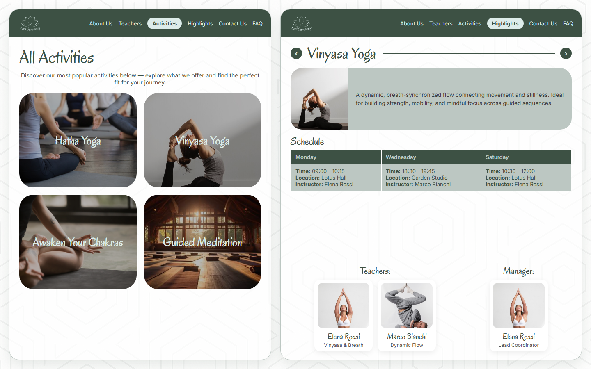
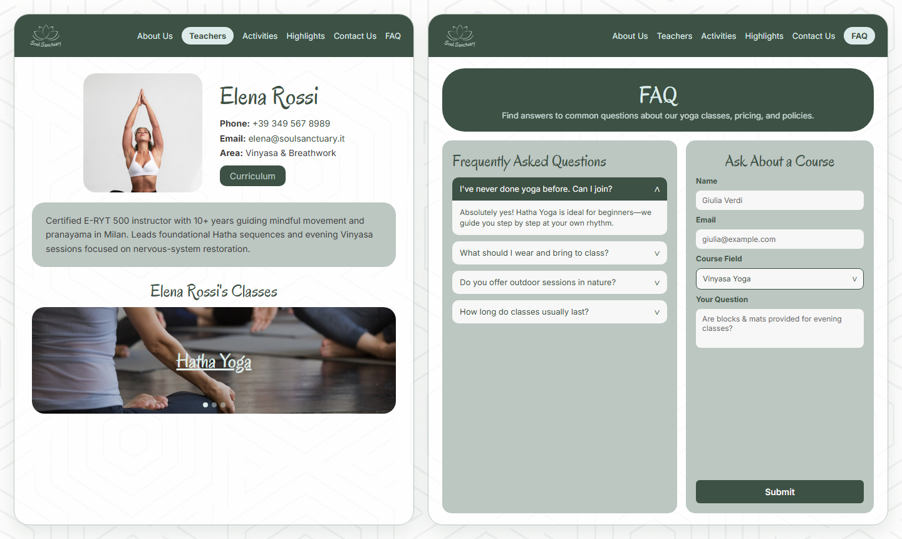
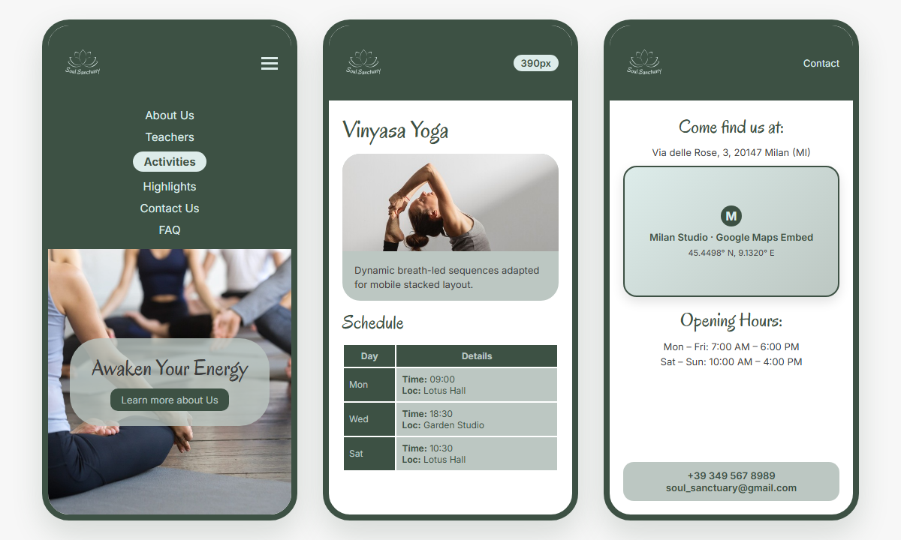
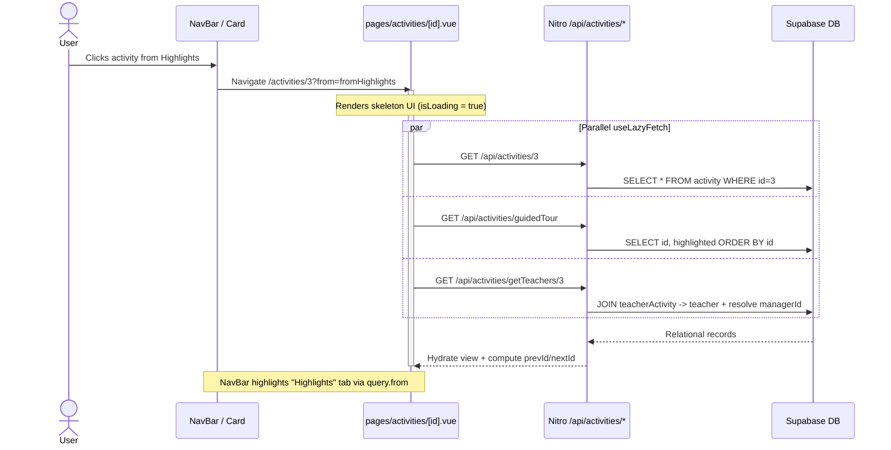
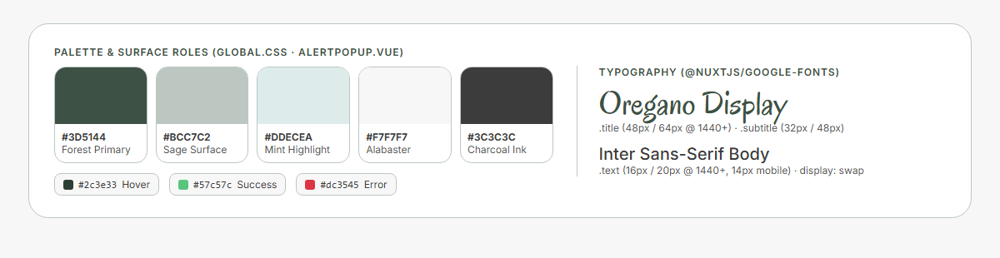
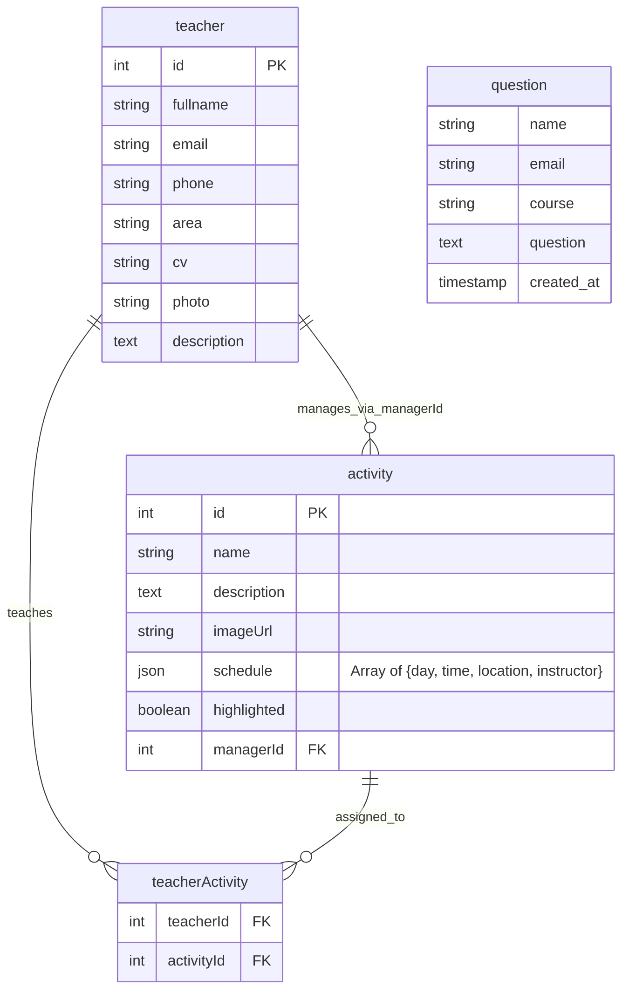

<div align="center">


<h1>Soul Sanctuary</h1>

<p>
  <strong>Full-Stack Yoga &amp; Holistic Wellness Studio Web Application</strong><br />
  <em>Politecnico di Milano · Hypermedia Applications (A.Y. 2024–2025)</em>
</p>

<p>
  
  
  
  
  
  
  
</p>

<p>
  <code>9 Nuxt Pages</code> &nbsp;&middot;&nbsp;
  <code>8 Nitro BFF APIs</code> &nbsp;&middot;&nbsp;
  <code>4 Supabase Tables</code> &nbsp;&middot;&nbsp;
  <code>8 Reusable Components</code> &nbsp;&middot;&nbsp;
  <code>@nuxt/image AVIF/WebP</code>
</p>

<p>
  <a href="#bento-ui-showcase">Showcase</a> &nbsp;&middot;&nbsp;
  <a href="#architecture--full-stack-pipeline">Architecture</a> &nbsp;&middot;&nbsp;
  <a href="#design-system">Design System</a> &nbsp;&middot;&nbsp;
  <a href="#frontend-implementation">Frontend</a> &nbsp;&middot;&nbsp;
  <a href="#backend-api--database">Backend API</a> &nbsp;&middot;&nbsp;
  <a href="#local-setup--scripts">Setup</a>
</p>

</div>

---

## Overview

**Soul Sanctuary** is a server-side rendered (SSR) web application built with **Nuxt 3** and **Supabase** for a Milan-based yoga and holistic wellness studio. Visitors can explore classes, discover instructors and course managers, follow a context-aware **Guided Tour** across activities or highlights, inspect responsive weekly schedules, browse studio information, and submit validated course inquiries persisted to PostgreSQL.

This repository (`HEAD` `3be2e6d`) separates the application source under [`soul_sanctuary/`](soul_sanctuary/) from documentation assets under [`documentation/`](documentation/).

---

## Bento UI Showcase

> **Note:** Because the live deployment (`soulsanctuary-ten.vercel.app`) and remote database are currently offline, the previews below were rendered locally in headless Chromium using the repository's exact CSS tokens, `Oregano` + `Inter` fonts, SVG marks, and studio photography from `soul_sanctuary/public/assets/`, paired with representative sample course/instructor records.

<table>
  <tr>
    <td colspan="2" align="center">
      <strong>Landing Experience &mdash; Home (<code>/</code>)</strong><br />
      <sub>Forest <code>#3D5144</code> NavBar &middot; Hero overlay over <code>homepage_rid1ancora.jpg</code> &middot; Studio stat circles &middot; Contact &amp; Highlights CTAs</sub><br /><br />
      
    </td>
  </tr>
  <tr>
    <td width="50%" align="center" valign="top">
      <strong>Catalog &amp; Context-Aware Guided Tour</strong><br />
      <sub><code>/activities</code> 2-column grid &amp; <code>/activities/[id]</code> with prev/next arrows, schedule table, teachers &amp; manager</sub><br /><br />
      
    </td>
    <td width="50%" align="center" valign="top">
      <strong>Instructor Profiles &amp; Accessible FAQ</strong><br />
      <sub><code>/teachers/[id]</code> bio + Swiper classes carousel &amp; <code>/faq</code> accordion + sticky validated inquiry form</sub><br /><br />
      
    </td>
  </tr>
  <tr>
    <td colspan="2" align="center">
      <strong>Responsive Mobile Views (<code>&le; 768px</code>)</strong><br />
      <sub>Hamburger drawer with ARIA state &middot; Stacked mobile <code>CourseScheduleTable</code> &middot; Studio map &amp; hours on <code>/contact_us</code></sub><br /><br />
      
    </td>
  </tr>
</table>

---

## Architecture & Full-Stack Pipeline

The application uses **Nuxt 3 Universal SSR** (`ssr: true` in [`nuxt.config.ts`](soul_sanctuary/nuxt.config.ts)) with **Nitro / h3** server routes acting as a Backend-for-Frontend (BFF) over **Supabase PostgreSQL**. Supabase credentials (`SUPABASE_URL`, `SUPABASE_KEY`) stay strictly server-side inside `soul_sanctuary/server/api/`.

```mermaid
flowchart LR
    Client["Browser / Crawler"] -->|HTTPS / SSR HTML| NuxtSSR["Nuxt 3 SSR Engine\n(app.vue + default.vue)"]
    NuxtSSR -->|Client Navigation\nuseLazyFetch + Skeletons| Pages["9 Vue 3 Pages\n+ 8 Components"]
    Pages -->|JSON REST Calls\n/api/*| Nitro["Nitro / h3 Server API\n(server/api/*.js)"]
    Nitro -->|@supabase/supabase-js| DB[("Supabase PostgreSQL\nactivity · teacher\nteacherActivity · question")]
    DB -->|Image URLs + ?quality=80&format=webp| ImgOpt["@nuxt/image\nAVIF / WebP / 1x-3x"]
    ImgOpt --> Pages
```

### How Frontend & Backend Work Together

1. **SSR & SEO Shell (`nuxt.config.ts` + per-page `useHead`)**: Every page renders server-side with route-specific `<Title>`, Open Graph, Twitter Card, `canonical` link, and JSON-LD `FAQPage` structured data on `/faq`.
2. **Non-Blocking Data Fetching (`useLazyFetch`)**: Dynamic pages (`/about`, `/activities`, `/activities/[id]`, `/highlights`, `/teachers`, `/teachers/[id]`) fetch from `/api/*` via `useLazyFetch` without blocking route transitions, rendering pulse/shimmer skeleton placeholders (`ActivityCard`, `TeacherCard`, `[id].vue`) until payloads and images resolve.
3. **Guided Tour & Provenance Tracking**: Navigating from `/highlights` attaches `?from=fromHighlights` to `/activities/[id]`. The detail page reads `/api/activities/guidedTour` to filter `prevId` / `nextId` within either all activities or only highlighted activities, while `NavBar.vue` keeps the originating tab (`Highlights` vs `Activities`) active.
4. **Media & Font Optimization**: `@nuxtjs/google-fonts` downloads `Oregano` and `Inter` locally with `display: 'swap'` and `<link rel="preload">`. `@nuxt/image` serves `avif`/`webp`/`png`/`jpg` across responsive `sizes` and `1x`/`2x`/`3x` densities, dynamically whitelisting the `SUPABASE_URL` hostname.
5. **Validated Write Pipeline (`POST /api/faq/form`)**: Submitting the FAQ course question form posts JSON to Nitro, which validates required fields, lengths (`name <= 100`, `question <= 1000`), and email format before inserting into Supabase `question` and driving `AlertPopup.vue` via `<Teleport to="body">`.



---

## Design System

Defined globally in [`assets/css/global.css`](soul_sanctuary/assets/css/global.css), [`layouts/default.vue`](soul_sanctuary/layouts/default.vue), and component styles, paired with a tiled [`wallpaper.webp`](soul_sanctuary/public/assets/webp/wallpaper.webp) backdrop under a 90% white wash (`rgba(255, 255, 255, 0.9)`).

<div align="center">
  
</div>

| Aspect | Specification |
|---|---|
| **Display Typography** | `Oregano` — `.title` (`48px` / `64px` at `>=1440px` / `36px` mobile), `.subtitle` (`32px` / `48px` / `24px`) |
| **Body Typography** | `Inter` — `.text` (`16px` / `20px` at `>=1440px` / `14px` mobile, `line-height: 1.5`) |
| **Responsive Breakpoints** | `480px` (compact mobile hiding secondary About media), `768px` / `800px` (hamburger nav, 1-col grids, stacked schedule table), `1200px` / `1300px` (tablet column wrap), `1440px+` (large-screen type scale) |
| **Micro-Interactions** | Shimmer/pulse image skeletons, hover brightness transitions on cards, grayscale-to-tinted social icon hover, custom WebKit scrollbars (`#3D5144` thumb on `#F7F7F7` track) |

---

## Frontend Implementation

### Routes & Pages (`soul_sanctuary/pages/`)

| Route | File | Data Fetching | Key Features |
|---|---|---|---|
| `/` | [`pages/index.vue`](soul_sanctuary/pages/index.vue) | Static + optimized local assets | Full-bleed hero overlay, `500+` / `90%` / `4` stat circles, Contact & Highlights CTA cards, closing mantra |
| `/about` | [`pages/about/index.vue`](soul_sanctuary/pages/about/index.vue) | `useLazyFetch('/api/activities')` | Hero shimmer skeleton, alternating story blocks (*What We Believe*, *Our History*, *Visit Us*), `ActivityCarousel` |
| `/activities` | [`pages/activities/index.vue`](soul_sanctuary/pages/activities/index.vue) | `useLazyFetch('/api/activities')` | Async `ActivityCard` 2-col → 1-col grid, 8 skeleton cards while pending, empty-state `aria-live` message |
| `/activities/[id]` | [`pages/activities/[id].vue`](soul_sanctuary/pages/activities/%5Bid%5D.vue) | `/api/activities/[id]`, `guidedTour`, `getTeachers/[id]` | Full-page skeleton, provenance-filtered Prev/Next tour, `CourseScheduleTable`, Teachers + Manager cards |
| `/highlights` | [`pages/highlights/index.vue`](soul_sanctuary/pages/highlights/index.vue) | `useLazyFetch('/api/highlights')` | Curated highlighted classes (`provenance="fromHighlights"`), 4 skeleton cards |
| `/teachers` | [`pages/teachers/index.vue`](soul_sanctuary/pages/teachers/index.vue) | `useLazyFetch('/api/teachers')` | Flex-wrap grid of `TeacherCard`s, 6 skeleton cards while pending |
| `/teachers/[id]` | [`pages/teachers/[id].vue`](soul_sanctuary/pages/teachers/%5Bid%5D.vue) | `/api/teachers/[id]`, `/api/teachers` | Prev/Next teacher arrows, contact links + external CV, bio card, *Classes* & conditional *Responsibilities* carousels |
| `/faq` | [`pages/faq/index.vue`](soul_sanctuary/pages/faq/index.vue) | `POST /api/faq/form` | 7 accordion items, `FAQPage` JSON-LD, sticky form with Teleported custom ARIA `combobox`/`listbox` (8 courses) |
| `/contact_us` | [`pages/contact_us/index.vue`](soul_sanctuary/pages/contact_us/index.vue) | Static | Google Maps embed (`Via delle Rose, 3, 20147 Milan`), opening hours, `tel:`/`mailto:` links, animated social icons |
| `*` (404) | [`error.vue`](soul_sanctuary/error.vue) | Static | Custom wallpaper-backed 404 recovery screen with Home CTA |

<details>
<summary><strong>Components &amp; Accessibility Highlights (8 Components)</strong></summary>

- [`NavBar.vue`](soul_sanctuary/components/NavBar.vue): Inline vector SVG logo (`#DDECEA`), zero-layout-shift bold hover trick via `::after { content: attr(data-text) }`, responsive hamburger drawer (`aria-expanded`, `aria-controls`), provenance-aware active pills.
- [`Footer.vue`](soul_sanctuary/components/Footer.vue): `#3D5144` studio footer with contact metadata, inverted SVG social links, team credits, and copyright.
- [`ActivityCard.vue`](soul_sanctuary/components/ActivityCard.vue): Shimmer loading overlay fading cleanly to `<nuxt-img>` once loaded, fallback `No-Image-Found-400x264.png`, provenance query forwarding.
- [`ActivityCarousel.vue`](soul_sanctuary/components/ActivityCarousel.vue): Swiper 11 carousel (`Navigation`, `Pagination`, `Autoplay` 3000 ms, loop) with per-slide image load tracking and shimmer skeletons.
- [`TeacherCard.vue`](soul_sanctuary/components/TeacherCard.vue): Aspect-ratio `17/24` instructor card with shimmer overlay and lazy/eager priority by `id`.
- [`CourseScheduleTable.vue`](soul_sanctuary/components/CourseScheduleTable.vue): Dual-markup responsive schedule rendering a horizontal weekly table on desktop and a stacked `Day | Details` table below `768px`, with `sr-only` table caption and `scope="col"` headers.
- [`FaqItem.vue`](soul_sanctuary/components/FaqItem.vue): Accessible accordion item swapping green/white SVG chevron icons across hover and expanded states.
- [`AlertPopup.vue`](soul_sanctuary/components/AlertPopup.vue): `<Teleport to="body">` modal displaying server validation errors or submission confirmation with `aria-live="assertive"`.

</details>

---

## Backend API & Database

All API handlers live in `soul_sanctuary/server/api/` and instantiate `@supabase/supabase-js` using `process.env.SUPABASE_URL` and `process.env.SUPABASE_KEY`. Missing environment variables return HTTP `500` (`Missing database configuration`).

### Nitro / h3 Endpoints

| Method | Endpoint | Handler | Behavior &amp; Query |
|---|---|---|---|
| `GET` | `/api/activities` | [`server/api/activities/index.js`](soul_sanctuary/server/api/activities/index.js) | Selects `id, name, imageUrl` from `activity` ordered by `id`; appends `?quality=80&format=webp` to `imageUrl`. |
| `GET` | `/api/activities/[id]` | [`server/api/activities/[id].js`](soul_sanctuary/server/api/activities/%5Bid%5D.js) | Selects `*` from `activity` matching `id`. |
| `GET` | `/api/activities/guidedTour` | [`server/api/activities/guidedTour/index.js`](soul_sanctuary/server/api/activities/guidedTour/index.js) | Selects `id, highlighted` ordered by `id` for prev/next tour navigation. |
| `GET` | `/api/activities/getTeachers/[id]` | [`server/api/activities/getTeachers/[id].js`](soul_sanctuary/server/api/activities/getTeachers/%5Bid%5D.js) | Joins `activity` → `teacherActivity` → `teacher` (`id, fullname, photo, area`) and fetches `manager` via `managerId`. |
| `GET` | `/api/highlights` | [`server/api/highlights/index.js`](soul_sanctuary/server/api/highlights/index.js) | Selects `*` from `activity` where `highlighted = true`, ordered by `id`. |
| `GET` | `/api/teachers` | [`server/api/teachers/index.js`](soul_sanctuary/server/api/teachers/index.js) | Selects `*` from `teacher` ordered by `id`. |
| `GET` | `/api/teachers/[id]` | [`server/api/teachers/[id].js`](soul_sanctuary/server/api/teachers/%5Bid%5D.js) | Joins `teacher` → `teacherActivity` → `activity` (`activities`) and queries `activity` where `managerId = id` (`managedActivities`). |
| `POST` | `/api/faq/form` | [`server/api/faq/form/index.js`](soul_sanctuary/server/api/faq/form/index.js) | Validates `name` (`<=100`), `email` (regex), `course`, and `question` (`<=1000`); inserts into `question` with `created_at`. |

### Relational Data Model

*(Inferred directly from the queries in `soul_sanctuary/server/api/*.js`; no SQL migration files are committed in this repository.)*



---

## Project Structure

```text
Hypermedia_Polimi_24-25/
├── README.md                          # Project overview, showcase & full-stack docs
├── documentation/
│   └── assets/                        # Logo emblem, design tokens & UI screenshots
└── soul_sanctuary/                    # Nuxt 3 full-stack application
    ├── app.vue                        # Root shell (NuxtRouteAnnouncer + NuxtLayout + NuxtPage)
    ├── error.vue                      # Custom 404 page
    ├── nuxt.config.ts                 # SSR, Google Fonts, @nuxt/image, SEO head defaults
    ├── package.json                   # Dependencies & npm scripts
    ├── assets/                        # global.css, SVGs, PNGs, JPGs
    ├── public/                        # Static photos, logos, wallpaper.webp, robots.txt, favicon.ico
    ├── layouts/default.vue            # NavBar + wallpaper backdrop + main + Footer
    ├── components/                    # 8 Vue 3 SFCs (Cards, Carousel, ScheduleTable, FaqItem, AlertPopup)
    ├── pages/                         # 9 file-based Nuxt routes
    └── server/api/                    # 8 Nitro/h3 Supabase endpoints
```

---

## Local Setup & Scripts

### Prerequisites

- **Node.js** (18+ / 20+ recommended for Nuxt 3.16) and `npm`
- A **Supabase** project with `activity`, `teacher`, `teacherActivity`, and `question` tables

### Environment Configuration

Create `soul_sanctuary/.env` with your Supabase credentials:

```env
SUPABASE_URL=https://<your-project-ref>.supabase.co
SUPABASE_KEY=<your-supabase-anon-or-service-key>
```

### Run Locally

```bash
cd soul_sanctuary
npm install
npm run dev        # Starts Nuxt dev server on http://localhost:3000
```

### Production Build & Preview

```bash
cd soul_sanctuary
npm run build      # SSR production bundle (.output/)
npm run preview    # Preview production build locally
npm run generate   # Static generation (where applicable)
```

---

## Team & License

Developed for the **Hypermedia Applications (2024–2025)** course at **Politecnico di Milano**:

- **Cotrone Mariariosaria**
- **De Ciechi Samuele**
- **Denti Silvia**
- **Di Lorenzo Flavio**

Licensed under the [MIT License](LICENSE).
